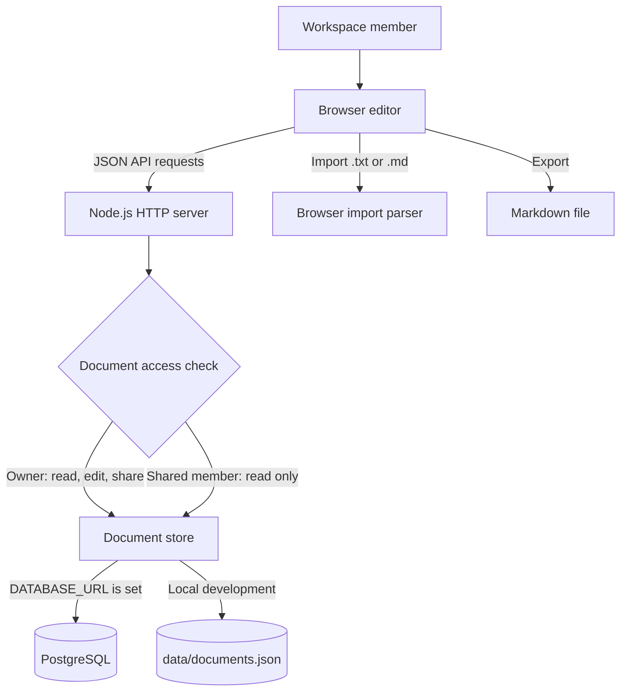

# DocDesk Architecture

DocDesk is a browser-based document editor with a small Node.js API. It stores rich-text documents, supports lightweight text import and Markdown export, and lets an owner share a read-only view with another demo member.

## Request and storage flow

## Components

- **Browser:** Plain HTML, CSS, and JavaScript. A `contenteditable` page and formatting toolbar support headings, emphasis, and lists. Save status is visible while edits are written.
- **API:** Node's built-in HTTP server serves the app and exposes JSON routes for documents, users, and sharing.
- **Persistence:** When `DATABASE_URL` is present, the server stores documents in PostgreSQL. Without it, local runs use `data/documents.json`. Records contain the title, rich-text HTML, owner, shared member names, and timestamps.
- **Sharing:** Three fixed demo identities are selected in the sidebar. The API checks ownership and membership; owners can edit and share, while shared members can read only. The identity selector is a demo aid, not authentication.
- **Files:** The browser imports `.txt` and `.md` files up to 1 MB, escaping text before turning it into HTML. Markdown export preserves headings, basic emphasis, lists, quotes, and safe links.

## Limits

The demo has no real accounts, concurrent editing, comments, or version history. The local JSON store is for one process. The server's small HTML allowlist is useful for this demo, but a public product with real users would need authentication and a mature HTML sanitizer.
